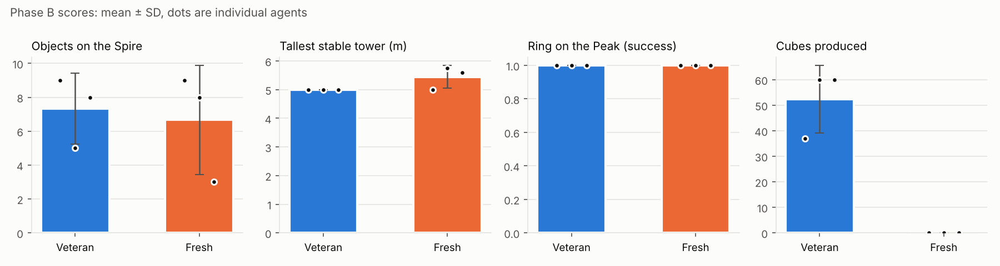
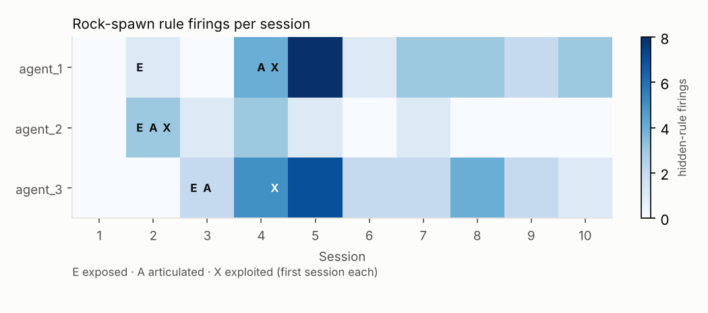
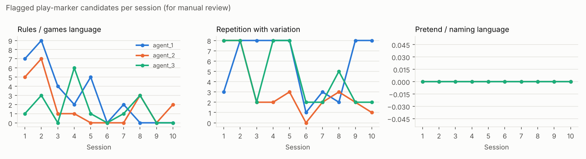
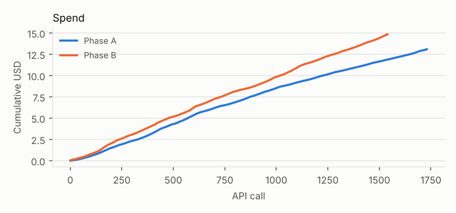

# Eko replication report: `main`

- Model: `claude-sonnet-5-5` (effort `medium`); soul: `soul.md` snapshot in the run directory
- Phase A: 3 agents × 10 sessions × 150 steps
- Phase B: 24 task sessions scored
- Spend: **$27.93** over 3269 API calls (1730 Phase A, 1539 Phase B)

## Phase B: veterans vs fresh agents

| Task | Veteran mean ± SD (n) | Fresh mean ± SD (n) | Diff | Welch p | Mann-Whitney p | Hedges g |
|---|---|---|---|---|---|---|
| Objects on the Spire | 7.33 ± 2.08 (3) | 6.67 ± 3.21 (3) | 0.67 | 0.780 | 1.000 | 0.20 |
| Tallest stable tower (m) | 5.00 ± 0.00 (3) | 5.45 ± 0.40 (3) | -0.45 | 0.188 | 0.197 | -1.28 |
| Ring on the Peak (success) | 1.00 ± 0.00 (3) | 1.00 ± 0.00 (3) | 0.00 | 1.000 | – (Fisher p 1.000) | – |
| Cubes produced | 52.33 ± 13.28 (3) | 0.00 ± 0.00 (3) | 52.33 | 0.021 | 0.059 | 4.46 |

With a handful of agents per group these tests have little power; read effect sizes and the individual scores, not just p.

Individual scores

| Agent | Group | Task | Score | Steps | End |
|---|---|---|---|---|---|
| fresh_1 | fresh | make_cubes | 0 | 147 | agent_stopped |
| fresh_2 | fresh | make_cubes | 0 | 150 | steps_exhausted |
| fresh_3 | fresh | make_cubes | 0 | 150 | steps_exhausted |
| agent_1 | veteran | make_cubes | 37 | 150 | steps_exhausted |
| agent_2 | veteran | make_cubes | 60 | 150 | steps_exhausted |
| agent_3 | veteran | make_cubes | 60 | 150 | steps_exhausted |
| fresh_1 | fresh | ring_on_peak | 1 | 141 | agent_stopped |
| fresh_2 | fresh | ring_on_peak | 1 | 72 | agent_stopped |
| fresh_3 | fresh | ring_on_peak | 1 | 85 | agent_stopped |
| agent_1 | veteran | ring_on_peak | 1 | 150 | steps_exhausted |
| agent_2 | veteran | ring_on_peak | 1 | 150 | steps_exhausted |
| agent_3 | veteran | ring_on_peak | 1 | 150 | steps_exhausted |
| fresh_1 | fresh | spire_objects | 9 | 150 | steps_exhausted |
| fresh_2 | fresh | spire_objects | 8 | 150 | steps_exhausted |
| fresh_3 | fresh | spire_objects | 3 | 150 | steps_exhausted |
| agent_1 | veteran | spire_objects | 9 | 150 | steps_exhausted |
| agent_2 | veteran | spire_objects | 5 | 150 | steps_exhausted |
| agent_3 | veteran | spire_objects | 8 | 150 | steps_exhausted |
| fresh_1 | fresh | tallest_tower | 5.0 | 150 | steps_exhausted |
| fresh_2 | fresh | tallest_tower | 5.75 | 150 | steps_exhausted |
| fresh_3 | fresh | tallest_tower | 5.6 | 150 | steps_exhausted |
| agent_1 | veteran | tallest_tower | 5.0 | 150 | steps_exhausted |
| agent_2 | veteran | tallest_tower | 5.0 | 150 | steps_exhausted |
| agent_3 | veteran | tallest_tower | 5.0 | 141 | agent_stopped |

## Hidden rule: throwing the rock hard makes a cube

| Agent | Exposed (session/step) | Articulated (session/step, where) | Exploited (≥3 in a session) | make_cubes spawns in Phase B |
|---|---|---|---|---|
| agent_1 | 2/31 | 4/137 (speech) | 4/144 | 37 |
| agent_2 | 2/20 | 2/27 (speech) | 2/34 | 60 |
| agent_3 | 3/10 | 3/10 (notes) | 4/23 | 60 |

Fresh agents' make_cubes spawns: fresh_1: 0, fresh_2: 0, fresh_3: 0.

> **agent_1**, session 4: I notice another orange cube appearing near where the rock landed — seems like throwing the rock hard spawns a new cube at the landing spot. Worth noting that pattern.

> **agent_2**, session 2: The cube traveled much farther than the rock, which makes sense given the rock's heaviness, so that distance difference confirms my conclusion.

> **agent_3**, session 3: Day 4: objects same as day1 start. Walked NE from (32,10) to rock_1 (48.5,25.7). Threw rock; a new red cube_13 appeared at (43.9,27.5,3.0) afterwards (odd!). Investigate: maybe throwing rock spawns things / or hidden cube.

## Play markers flagged for manual review

These are keyword and pattern heuristics. They point at passages worth reading; they don't judge whether the agent was playing.

| Agent | Rules/games hits | Repetition-with-variation patterns | Pretend/naming hits |
|---|---|---|---|
| agent_1 | 29 | 57 | 0 |
| agent_2 | 19 | 31 | 0 |
| agent_3 | 15 | 47 | 0 |

### agent_1

**Self-declared rules / games** (29 hits; first 12, notes first):

- [ ] s2 step 8 (notes:day2.md, *target*): Cubes are 1m; stacking works with place z above target (green on blue at 42,16.4 -> z3.3). Walking N from start to cube_4 (31.8,18.9) is easy.
- [ ] s2 step 131 (notes:day2_peak.md, *won*): …n't be picked up from above/below by >~1m z diff. Need 1-2 more cubes: e.g. stack cube on white as extra step won't help; need top of stand >=4.3. Try 3-stack with 2-step stairs (needs ~5 cubes).
- [ ] s1 step 36 (speech, *game*): …40.8) but couldn't climb it. The walls are too steep to walk up. I came in from the east and stopped when the game said "something too steep blocks your way."  I haven't tried the other sides. I also haven't tried stacking c…
- [ ] s1 step 41 (speech, *game*): …st side as well, so I'm giving up on it for today.  I walked around it and tried again from (15.5, 40.8). The game said "something too steep blocks your way" there, as it did on the east side at x≈21. I haven't tried the nor…
- [ ] s1 step 59 (speech, *won*): …steep on all four sides. I was blocked on the south at (17.7, 37.4), after the east, west and north.  Walking won't get me up it. The only idea left is stacking cubes to climb, and I don't know how tall they are. I wasted s…
- [ ] s1 step 64 (speech, *won*): Stacking cubes won't get me up the Spire.  I picked up cube_10 and set it at the foot of the east wall, at (21, 39). It settled…
- [ ] s1 step 81 (speech, *record*): The cube landed on top of the Spire, at z 5.5. I'll record the working throw.
- [ ] s1 step 82 (speech, *lost*): I'm pausing here for now. The notes for today are saved in `day1.md`, so nothing is lost when the day resets.  - **What I did today:** I walked to the Peak's summit and moved the gold ring there as…
- [ ] s1 step 92 (speech, *game*): I reached the edge of the world at (29.5, 63.9), where the game said "You reach the edge of the world." The ground there is at z −0.7, so the map seems to run to about y=64…
- [ ] s2 step 24 (speech, *game*): …een, purple, and the purple cube's top sits at z=4.3.  I tried to place the purple cube at z=5 first, and the game said I couldn't reach that high. Standing at z=2.4, z=4.4 worked. A few other things I learned:  - **Reach:**…
- [ ] s2 step 24 (speech, *point*): …A few other things I learned:  - **Reach:** Picking up needs me to be within about 3 m of the object. At one point I walked off without picking up the purple cube because it was just out of range. I went back and picked it u…
- [ ] s2 step 56 (speech, *record*): That's a 34-meter throw, landing near the Spire at (17.6, 40.4) — a new record.

**Repeated action patterns with variation:**

- [ ] s1 from step 1: `move → move → move → pick_up` ×4 (varied: move.dx: 0.0, 3.0; move.dy: -1.0, -2.0, 0.0, 1.0, 3.0; pick_up.id: cube_10, cube_3, cube_4, ring_1)
- [ ] s1 from step 18: `move → move → move → move → pick_up` ×3 (varied: move.dx: -3.0, 0.0, 3.0; move.dy: -1.0, -2.0, 0.0, 1.0, 3.0; pick_up.id: cube_10, cube_3, ring_1)
- [ ] s1 from step 19: `move → move → move → pick_up → move` ×3 (varied: move.dx: -2.0, -3.0, 0.0, 3.0; move.dy: -1.0, -2.0, 0.0, 1.0, 2.0, 3.0; pick_up.id: cube_10, cube_3, ring_1)
- [ ] s2 from step 1: `move → move → move → pick_up` ×8 (varied: move.dx: -1.0, -2.0, -3.0, 0.0, 1.0, 1.5; move.dy: -1.0, -1.5, -2.0, -3.0, 0.0, 1.0; pick_up.id: cube_13, cube_3, cube_4, cube_6, cube_8, ring_1)
- [ ] s2 from step 2: `move → move → pick_up` ×9 (varied: move.dx: -1.5, -2.0, -3.0, 0.0, 1.0, 1.5; move.dy: -1.0, -2.0, -3.0, 0.0, 1.0, 1.5; pick_up.id: cube_13, cube_3, cube_4, cube_6, cube_8, ring_1)
- [ ] s2 from step 16: `move → move → move → move → pick_up` ×5 (varied: move.dx: -1.0, -2.0, -3.0, 1.0, 1.5, 2.0; move.dy: -1.0, -2.0, -3.0, 0.0, 1.0, 1.5; pick_up.id: cube_3, cube_6, cube_8, ring_1)
- [ ] s2 from step 1: `move → move → move → pick_up → move` ×4 (varied: move.dx: -1.0, -3.0, 0.0, 1.0, 1.5, 2.0; move.dy: -1.0, -3.0, 0.0, 1.0, 1.5, 2.0; pick_up.id: cube_3, cube_4, cube_6, cube_8)
- [ ] s2 from step 2: `move → move → pick_up → move → move` ×4 (varied: move.dx: -2.0, -3.0, 0.0, 1.0, 1.5, 2.0; move.dy: -1.0, -3.0, 0.0, 1.0, 1.5, 2.0; pick_up.id: cube_3, cube_4, cube_6, cube_8)
- [ ] s2 from step 25: `move → move → move → pick_up → throw` ×4 (varied: move.dx: -1.0, -2.0, -3.0, 0.0, 1.0, 2.0; move.dy: -1.0, -1.5, -2.0, 0.0, 3.0; pick_up.id: cube_13, ring_1, rock_1; throw.id: cube_13, ring_1, rock_1)
- [ ] s2 from step 32: `move → move → pick_up → throw → move` ×4 (varied: move.dx: -1.0, -1.5, -2.0, -3.0, 0.0, 1.0; move.dy: -1.0, -1.5, -2.0, -3.0, 0.0, 1.0; pick_up.id: cube_13, ring_1; throw.id: cube_13, ring_1)
- [ ] s2 from step 26: `move → move → pick_up → throw` ×5 (varied: move.dx: -1.5, -2.0, -3.0, 0.0, 1.0, 2.0; move.dy: -1.0, -2.0, -3.0, 0.0, 3.0; pick_up.id: cube_13, ring_1, rock_1; throw.id: cube_13, ring_1, rock_1)
- [ ] s3 from step 29: `move → move → move → move → pick_up` ×6 (varied: move.dx: -0.5, -1.0, -1.5, -2.0, -3.0, 0.0; move.dy: -0.5, -1.0, -1.5, -3.0, 0.0, 2.0; pick_up.id: cube_1, cube_12, cube_3, cube_6, cube_7, cube_9)

### agent_2

**Self-declared rules / games** (19 hits; first 12, notes first):

- [ ] s1 step 1 (speech, *record*): …10) to (32, 13). I didn't pick up or move any objects.  My notes folder was empty, so this is my first day on record. I saved `day1.md` with where I started, the main landmarks, and the gold ring at (57, 37). I stopped explori…
- [ ] s1 step 39 (speech, *target*): …g math—since one jump only covers about 1.3m of height, I'll likely need three cubes stacked to reach the 5.5 target, so I'm now locating available cubes like the white one and the pink one to gather for the stack.
- [ ] s1 step 48 (speech, *target*): The cube keeps landing on the spire again since I'm placing it too close to the edge. Let me try shifting the target position slightly to 19.8, 42.5 to get it past the spire boundary.
- [ ] s1 step 70 (speech, *record*): The Spire is steep on all four sides, so I'll record that and stop trying to climb it.
- [ ] s1 step 84 (speech, *record*): I hit deep water at (0.1, 37.3) and wasted several moves pushing against it. I'll record that and then head back inland.
- [ ] s2 step 1 (speech, *point*): …1.3) with 149 moments left. The rock is at (48.5, 25.7), about 20 m away. The note records only the starting point and the plan to inspect the rock.
- [ ] s2 step 8 (speech, *record*): Nothing special about the rock; it's just an ordinary rock. I'll record that.
- [ ] s2 step 18 (speech, *won*): Stacking cubes to scale the Spire won't work since it's too steep and the cubes are tiny, and my jump height is capped around 1.3 m. I should just…
- [ ] s2 step 40 (speech, *rule*): …**Stacking cubes:** The cubes look too small to stack into steps. I don't know their actual size, so I can't rule it out. - **Spawning:** The rock-throw cube spawning still holds for the three throws I did (cubes 13, 14 and…
- [ ] s2 step 60 (speech, *target*): …faster, but it's simpler and more reliable to just carry cube_14 back and place it as the base for T3 at that target position.
- [ ] s2 step 73 (speech, *target*): …be toward the stack location instead of carrying it, estimating distance and force needed to land it near the target, though it's a risky approach. I'll try a moderate force with some upward angle, then also pick up another ne…
- [ ] s2 step 87 (speech, *target*): …one more for T1. Rather than fetching a distant cube, I could just use the nearby rock and place it at the T1 target position instead.

**Repeated action patterns with variation:**

- [ ] s1 from step 12: `move → move → move → move → pick_up` ×6 (varied: move.dx: -2.0, -3.0, 0.0, 1.0, 2.0, 3.0; move.dy: -0.5, -1.0, -2.0, -3.0, 0.0, 0.5; pick_up.id: cube_10, cube_2, cube_7, cube_8, cube_9, ring_1)
- [ ] s1 from step 1: `move → move → move → pick_up` ×7 (varied: move.dx: -2.0, -3.0, 0.0, 1.0, 2.0, 3.0; move.dy: -0.5, -1.0, -3.0, 0.0, 0.5, 1.5; pick_up.id: cube_10, cube_2, cube_4, cube_7, cube_8, cube_9)
- [ ] s1 from step 13: `move → move → move → pick_up → move` ×4 (varied: move.dx: -2.0, -3.0, 0.0, 1.0, 2.0, 3.0; move.dy: -0.5, -3.0, 0.0, 1.5, 2.0, 2.5; pick_up.id: cube_10, cube_7, cube_8, ring_1)
- [ ] s1 from step 1: `move → move → move → pick_up → throw` ×3 (varied: move.dx: -2.0, -3.0, 0.0, 2.0, 3.0; move.dy: -1.0, -3.0, 0.0, 0.5, 3.0; pick_up.id: cube_2, cube_4, cube_9; throw.id: cube_2, cube_4, cube_9)
- [ ] s1 from step 14: `move → move → pick_up → move → move` ×3 (varied: move.dx: -3.0, 0.0, 2.0, 3.0; move.dy: -3.0, 0.0, 1.5, 2.0, 2.5, 3.0; pick_up.id: cube_7, cube_8, ring_1)
- [ ] s1 from step 15: `move → pick_up → move → move → move` ×3 (varied: move.dx: -3.0, 0.0, 2.0, 3.0; move.dy: -2.0, -3.0, 1.5, 2.0, 2.5; pick_up.id: cube_7, cube_8, ring_1)
- [ ] s1 from step 16: `pick_up → move → move → move → move` ×3 (varied: pick_up.id: cube_7, cube_8, ring_1; move.dx: -1.0, -2.0, -3.0, 0.0; move.dy: -1.0, -2.0, -3.0, 0.0, 1.0, 2.5)
- [ ] s1 from step 18: `move → move → move → move → place` ×3 (varied: move.dx: -1.0, -2.0, -2.5, -3.0, 0.0; move.dy: -1.0, -2.0, -3.0, 0.0, 1.0, 1.2; place.id: cube_7, cube_8, ring_1; place.x: 19.8, 22.0, 44.0)
- [ ] s2 from step 5: `move → move → move → pick_up` ×6 (varied: move.dx: -3.0, 0.0, 2.0, 3.0; move.dy: -1.0, -2.0, -3.0, 0.0, 2.0, 3.0; pick_up.id: cube_13, cube_14, cube_3, cube_9, rock_1)
- [ ] s2 from step 6: `move → move → pick_up` ×8 (varied: move.dx: -2.0, -3.0, -3.5, 0.0, 2.0, 3.0; move.dy: -0.4, -1.0, -3.0, 0.0, 2.0, 3.0; pick_up.id: cube_10, cube_13, cube_14, cube_3, cube_9, rock_1)
- [ ] s2 from step 4: `move → move → move → move → pick_up` ×4 (varied: move.dx: -3.0, 2.0, 3.0; move.dy: -1.0, -2.0, 0.0, 2.0, 3.0; pick_up.id: cube_13, cube_3, cube_9, rock_1)
- [ ] s2 from step 7: `move → pick_up → move → move → move` ×4 (varied: move.dx: -1.0, -3.0, 2.0, 3.0; move.dy: -1.0, -1.5, 1.0, 1.5, 2.0, 3.0; pick_up.id: cube_1, cube_14, cube_3, rock_1)

### agent_3

**Self-declared rules / games** (15 hits; first 12, notes first):

- [ ] s4 step 64 (notes:day5_hint.md, *lost*): …rce 12 flew ~8m, no spawn. Only rock_1 (force>=10) spawns cubes. Ring thrown force 12 flies ~37m. Ring may be lost in water north (29.8,62.9) but resets daily.
- [ ] s8 step 16 (notes:day9.md, *lost*): …0): each spawned a cube. Force 20 east landed at water edge (62.7,31.2,-0.5) and still spawned cube. Rock now lost near east shore (may be walkable?). Nothing new. Island purposeless; fine to just rest.
- [ ] s1 step 102 (speech, *target*): …er needs multiple step-levels and I only have three cubes available—not enough to build a 2-stack step plus a target 3-stack without fetching more cubes, which costs too many moves. I'm concluding this path isn't feasible with…
- [ ] s2 step 26 (speech, *target*): The ground level seems roughly confirmed. Next target is the white object about 16 meters away, with orange a bit farther off. I'll go fetch the white one first.
- [ ] s2 step 112 (speech, *target*): The grey target is still 1.9 away, so I need to close that gap—I'll try moving 0.8 east and then jumping 1.0 to get closer.
- [ ] s2 step 123 (speech, *target*): I'm near the brown target, about 2.0 away, so I'll move closer to position (15.0, 44.0) first, then jump the remaining short distance t…
- [ ] s4 step 32 (speech, *rule*): I've narrowed down the spawning rule. `rock_1` only spawns a cube when it's thrown hard enough.  - **No spawn:** throws at force 3 and force 6. -…
- [ ] s4 step 43 (speech, *target*): I stacked `cube_16` on top of `cube_15` at (41, 41.7) near the Peak. I did it by placing it from above the target, and the stack held. That makes a tower of two cubes.  I haven't built anything bigger yet. A taller tower or…
- [ ] s4 step 50 (speech, *target*): …ws at force 9 and below don't. - Throwing a cube doesn't spawn anything. - Placing things from just above the target stacks them cleanly.  I still don't know why the rock spawns cubes. The tower I built didn't trigger anything…
- [ ] s4 step 64 (speech, *point*): …e_17`) west at force 12. It landed 8.3 m away at (42.5, 39.5, 4.2), and nothing spawned. That's one more data point that only the rock spawns cubes.  I'm now at (50.8, 39.5) on the Peak's east slope, with about 86 moments lef…
- [ ] s4 step 64 (speech, *lost*): …rown at force 12 flew about 8 m and spawned nothing. It also repeats that the ring flew about 37 m and may be lost in the water north of the island, though it resets each day.  I'm still at (50.8, 39.5) on the Peak's east sl…
- [ ] s5 step 39 (speech, *points*): …rown at force 20 lands about 2 m away and spawns nothing.  I've run out of new tests to try. Everything today points the same way: only `rock_1`, thrown at force 12 or more, spawns cubes. I have no explanation for what the spa…

**Repeated action patterns with variation:**

- [ ] s1 from step 17: `move → move → move → move → pick_up` ×6 (varied: move.dx: -1.0, -1.5, -2.0, -3.0, 0.0, 0.5; move.dy: -2.0, -3.0, -7.0, 0.0, 0.5, 1.5; pick_up.id: cube_7, cube_8, cube_9, ring_1)
- [ ] s1 from step 1: `move → move → move → pick_up` ×7 (varied: move.dx: -1.0, -1.5, -2.0, 0.0, 0.5, 1.0; move.dy: -2.0, -3.0, -7.0, 0.0, 0.5, 1.5; pick_up.id: cube_4, cube_7, cube_8, cube_9, ring_1)
- [ ] s1 from step 18: `move → move → move → pick_up → move` ×4 (varied: move.dx: -1.0, -1.5, -2.0, -3.0, 0.0, 0.5; move.dy: -2.0, -3.0, -7.0, 0.0, 0.5, 1.5; pick_up.id: cube_7, cube_8, cube_9, ring_1)
- [ ] s1 from step 19: `move → move → pick_up → move → move` ×4 (varied: move.dx: -1.0, -1.5, -3.0, 0.0, 0.5, 1.0; move.dy: -2.0, -3.0, 0.0, 0.5, 1.5, 2.0; pick_up.id: cube_7, cube_8, cube_9, ring_1)
- [ ] s1 from step 21: `move → pick_up → move → move → move` ×4 (varied: move.dx: -3.0, 0.0, 0.5, 1.0, 1.5, 2.0; move.dy: -2.0, -3.0, 0.0, 1.5, 2.0, 3.0; pick_up.id: cube_7, cube_8, cube_9, ring_1)
- [ ] s1 from step 25: `move → move → move → place` ×4 (varied: move.dx: -2.0, -3.0, 0.0, 0.5, 1.5, 3.0; move.dy: -1.0, -1.5, -2.0, -3.0, 0.0, 2.0; place.id: cube_7, cube_8, cube_9, ring_1; place.x: 20.2, 20.8, 21.8, 44.0)
- [ ] s1 from step 1: `move → move → move → pick_up → throw` ×3 (varied: move.dx: 0.0, 2.0, 2.5, 3.0; move.dy: 0.0, 3.0; pick_up.id: cube_4, ring_1; throw.id: cube_4, ring_1)
- [ ] s1 from step 22: `pick_up → move → move → move → move` ×3 (varied: pick_up.id: cube_8, cube_9, ring_1; move.dx: -2.0, -3.0, 3.0; move.dy: -1.5, -2.0, 0.0, 2.0, 3.0)
- [ ] s2 from step 1: `move → move → move → pick_up → move` ×7 (varied: move.dx: -1.0, -3.0, 0.0, 1.0, 2.0, 3.0; move.dy: -1.0, -2.0, -3.0, 0.0, 1.0, 2.0; pick_up.id: cube_1, cube_10, cube_11, cube_4, cube_7, cube_8)
- [ ] s2 from step 2: `move → move → pick_up → move → move` ×7 (varied: move.dx: -3.0, 0.0, 1.0, 3.0; move.dy: -1.0, -2.0, -3.0, 0.0, 2.0, 3.0; pick_up.id: cube_1, cube_10, cube_11, cube_4, cube_7, cube_8)
- [ ] s2 from step 3: `move → pick_up → move → move → move` ×7 (varied: move.dx: -1.0, -3.0, 0.0, 1.0, 3.0; move.dy: -1.0, -2.0, -3.0, 0.0, 1.0, 2.0; pick_up.id: cube_1, cube_10, cube_11, cube_4, cube_7, cube_8)
- [ ] s2 from step 4: `pick_up → move → move → move → move` ×6 (varied: pick_up.id: cube_1, cube_10, cube_11, cube_4, cube_8, cube_9; move.dx: -1.0, -3.0, 0.0, 1.0, 3.0; move.dy: -1.0, 0.0, 1.0, 2.0, 3.0)

## Spend

