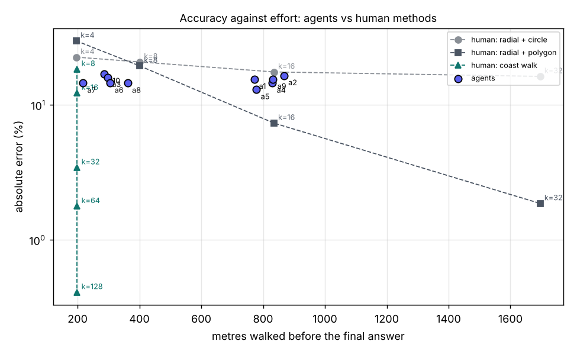

# Challenge report: `math2`

**Question:** A voice carries over the island: "What is the perimeter of the island?" When you have an answer, give it with the answer tool. You may answer again if you refine it.

**True answer:** 198.8 (computed from the world: shoreline_perimeter)

| agent | final answer | error | given on day | explanation (start) |
|---|---|---|---|---|
| agent_1 | 168  | -15.5% | 2 | From my earlier shore probes, the island is roughly a circle of radius about 26.7, so the perimeter is about 2πr ≈ 168. This is an estimate  |
| agent_10 | 165 units | -17.0% | 2 | Probes: W edge r~26, E edge r~27-28, NW r~21, others ~24-33; average radius ~26.3, perimeter ≈ 2*pi*26.3 ≈ 165. |
| agent_2 | 166 units | -16.5% | 2 | Final estimate: 2*pi*~26.4 mean shore radius, consistent with the latest probe (radius ~27 at the south-west) |
| agent_3 | 167 units | -16.0% | 2 | Estimated from nine shore probes. The island is lumpy, with a mean shore radius of about 26.7 from the origin, which gives a perimeter of ab |
| agent_4 | 170 units | -14.5% | 2 | From my notes: 16-direction shore measurements averaged radius ≈26.6, giving a perimeter of about 167-170. |
| agent_5 | 173  | -13.0% | 2 | Mean edge radius is about 27.4 across all probes, so the perimeter is about 2*pi*27.4 ≈ 172 to 173. The radius ranges from 24 to 31. |
| agent_6 | 170  | -14.5% | 2 | Final estimate from shoreline sampling at eight or more compass points. The mean radius is about 27.1, so the perimeter is about 2*pi*27.1,  |
| agent_7 | 170  | -14.5% | 2 | From memory: edge probing gave mean radius ~27, so perimeter ≈ 2π·27 ≈ 170. |
| agent_8 | 170 units | -14.5% | 2 | From memory: nine edge points probed give a polygon perimeter of about 167.3, rounded up to 170 to allow for curvature. |
| agent_9 | 168 units | -15.5% | 2 | The mean shore radius is about 26.8 from a 16-direction sweep, which gives 2*pi*26.8, or about 168. Two probes this session, with radii of a |

Answered: 10/10. Median absolute error: 15.0%; within 5%: 0; within 10%: 0.

## Efficiency and novelty against human methods

Human baselines are scripted and run in the same world, so their numbers are exact. Walking is the effort that dominates for a person; a coast walk always covers the whole coastline.

| human method | k | estimate | error | metres walked |
|---|---|---|---|---|
| radial + circle | 4 | 153.9 | -22.6% | 196 |
| radial + polygon | 4 | 139.6 | -29.8% | 196 |
| radial + circle | 8 | 157.5 | -20.8% | 401 |
| radial + polygon | 8 | 160.2 | -19.4% | 401 |
| radial + circle | 16 | 164.0 | -17.5% | 835 |
| radial + polygon | 16 | 184.2 | -7.3% | 835 |
| radial + circle | 32 | 166.5 | -16.3% | 1696 |
| radial + polygon | 32 | 195.1 | -1.9% | 1696 |
| coast walk | 8 | 162.3 | -18.4% | 199 |
| coast walk | 16 | 174.5 | -12.2% | 199 |
| coast walk | 32 | 192.0 | -3.4% | 199 |
| coast walk | 64 | 195.3 | -1.8% | 199 |
| coast walk | 128 | 197.5 | -0.7% | 199 |

| agent | method (from what it did) | answer | error | walked m | actions | sim. min | cost | calcs | coast covered | coast visits |
|---|---|---|---|---|---|---|---|---|---|---|
| agent_1 | radial + circle | 168 | -15.5% | 773 | 36 | 19 | $0.47 | 1 | 37% | 15 |
| agent_10 | radial + circle | 165 | -17.0% | 286 | 24 | 23 | $0.59 | 0 | 33% | 8 |
| agent_2 | radial + circle | 166 | -16.5% | 868 | 38 | 21 | $0.50 | 1 | 46% | 17 |
| agent_3 | radial + circle | 167 | -16.0% | 298 | 26 | 19 | $0.53 | 0 | 35% | 9 |
| agent_4 | radial + circle | 170 | -14.5% | 830 | 32 | 19 | $0.47 | 4 | 48% | 16 |
| agent_5 | radial + circle | 173 | -13.0% | 779 | 32 | 21 | $0.49 | 3 | 44% | 16 |
| agent_6 | radial + circle | 170 | -14.5% | 306 | 23 | 20 | $0.47 | 0 | 27% | 8 |
| agent_7 | radial + circle | 170 | -14.5% | 218 | 19 | 19 | $0.49 | 0 | 24% | 5 |
| agent_8 | radial + polygon | 170 | -14.5% | 362 | 30 | 19 | $0.96 | 3 | 33% | 9 |
| agent_9 | radial + circle | 168 | -15.5% | 832 | 40 | 23 | $0.54 | 1 | 52% | 16 |

- Methods used: radial + circle x9, radial + polygon x1.
- Agents more accurate than the best human method that walks no further: 0/10.
- Novel (matches no human method): 0/10; rarest method in this cohort: radial + polygon (1).

## How each agent got there

### agent_1, day 1
36 walks, 2 observations, 1 calculations, 4 answers.

- step 24: `sum([sqrt(a*a+b*b-2*a*b*cos(pi/4)) for a,b in [(20,28.4),(28.4,26.8),(26.8,18.6),(18.6,25),(25,34),(34,29),(29,24),(24,20)]])` = Could not evaluate: unsupported expression element: ListComp

**Answer at step 3: 154 ** (-22.5% vs truth)

> Estimated the island as roughly circular with radius ≈24.5, based on the ground dropping off at about 22–27 units from the center. The perimeter is 2πr ≈ 154. I only probed two directions, so this is a rough estimate.

**Answer at step 24: 162 ** (-18.5% vs truth)

> I probed 8 directions from the center and found shore distances of about 20, 28, 27, 19, 25, 34, 29 and 24. The mean radius is about 25.7, so the perimeter is roughly 2π × 25.7 ≈ 161–162. The shore is irregular, so this is still an estimate.

**Answer at step 32: 163 ** (-18.0% vs truth)

> Four more probes at in-between angles gave shore radii of about 26.4, 26.6 and 24.6. The fourth was blocked by the Spire mesa and gave no shore reading. Together with the earlier 8 directions, the island looks close to a circle of radius about 26, with a few odd readings that were probably obstacles. That gives a perimeter of 2π × 26 ≈ 163.

**Answer at step 36: 168 ** (-15.5% vs truth)

> I took 13 shore readings in total. The east reading of 20 was wrong: a block stopped me short of the shore. Dropping the obstacle-blocked readings (20, 19 and the Spire probe), the mean shore radius is about 26.7. That gives a perimeter of 2π × 26.7 ≈ 168. It is still an estimate.

### agent_1, day 2
0 walks, 2 observations, 0 calculations, 1 answers.

**Answer at step 0: 168 ** (-15.5% vs truth)

> From my earlier shore probes, the island is roughly a circle of radius about 26.7, so the perimeter is about 2πr ≈ 168. This is an estimate and the shore is irregular.

### agent_10, day 1
14 walks, 3 observations, 0 calculations, 3 answers.

**Answer at step 2: 173 units** (-13.0% vs truth)

> Rough estimate: the island looks roughly circular and centered near the origin. Walking outward, I was stopped at a radius of about 27–28 from the center. That gives 2π·27.5 ≈ 173. I only probed the north edge, so the other sides are assumed to match.

**Answer at step 7: 170 units** (-14.5% vs truth)

> Refined estimate. I probed north, east, west and southwest. The edge sits at a radius of roughly 22–33 depending on direction, and averages about 27. That gives 2π·27 ≈ 170.

**Answer at step 12: 163 units** (-18.0% vs truth)

> Re-estimated after adding a south probe. The edge was at a radius of about 24 there. Averaged with the earlier readings, the radius is about 26, so the perimeter is 2π·26 ≈ 163. It is still an estimate.

### agent_10, day 2
11 walks, 2 observations, 0 calculations, 2 answers.

**Answer at step 0: 163 units** (-18.0% vs truth)

> From memory: island roughly circular, average edge radius ~26 from probing several directions, so perimeter ≈ 2*pi*26 ≈ 163.

**Answer at step 9: 165 units** (-17.0% vs truth)

> Probes: W edge r~26, E edge r~27-28, NW r~21, others ~24-33; average radius ~26.3, perimeter ≈ 2*pi*26.3 ≈ 165.

### agent_2, day 1
37 walks, 2 observations, 1 calculations, 3 answers.

- step 25: `sum([hypot(a*cos(radians(t))-b*cos(radians(u)), a*sin(radians(t))-b*sin(radians(u))) for a,t,b,u in [(20,0,26.4,22.5),(26.4,22.5,24,45),(24,45,26.6,67.5),(26.6,67.5,29,90),(29,90,24.6,112.5),(24.6,112.5,34,135),(34,135,25,180),(25,180,18.6,225),(18.6,225,26.8,270),(26.8,270,28.4,315),(28.4,315,20,360)]])` = Could not evaluate: unsupported expression element: ListComp

**Answer at step 0: 157 ** (-21.0% vs truth)

> Rough estimate: the island looks roughly circular with a radius of about 25 units, so the perimeter is 2·pi·25. I didn't measure the shoreline directly.

**Answer at step 17: 165 ** (-17.0% vs truth)

> I walked outward from the center in 8 directions until the ground dropped to the waterline. The radii were 20, 24, 29, 34, 25, 18.6, 26.8 and 28.4, with a mean of about 25.7. The shore is irregular, so I took 2·pi·25.7 ≈ 161 and rounded up a little to about 165 for the wiggles.

**Answer at step 33: 166 ** (-16.5% vs truth)

> I took shore readings in 19 directions. The mean radius is about 26.4, so the perimeter is about 2·pi·26.4 ≈ 166. The shoreline is irregular, so this is still an estimate.

### agent_2, day 2
3 walks, 1 observations, 0 calculations, 2 answers.

**Answer at step 0: 166 units** (-16.5% vs truth)

> Estimated from probing shore radius in 19 directions (mean about 26.4); perimeter about 2*pi*26.4. Approximate.

**Answer at step 1: 166 units** (-16.5% vs truth)

> Final estimate: 2*pi*~26.4 mean shore radius, consistent with the latest probe (radius ~27 at the south-west)

### agent_3, day 1
26 walks, 3 observations, 0 calculations, 5 answers.

**Answer at step 0: 157 ** (-21.0% vs truth)

> Rough estimate. The world data gives no explicit shoreline. The hills and objects span about 50 units across, so I treated the island as a circle of radius about 25 and used 2πr.

**Answer at step 4: 170 ** (-14.5% vs truth)

> Refined estimate. Walking south from the start, I reached the edge at about z=-27, where the ground dropped away. With the island centered near the origin, that gives a radius of about 27. 2π·27 ≈ 170. I only probed one edge point, so this is still approximate.

**Answer at step 18: 165 ** (-17.0% vs truth)

> I walked to the edge in four directions: south z≈-27, north z≈28, east x≈25 and west x≈-25. That fits an ellipse with semi-axes of about 25 and 27.5. Ramanujan's approximation gives a perimeter of about 165. The south-west edge looked closer in, at a radius of about 22, so the shape isn't a perfect ellipse.

**Answer at step 22: 166 ** (-16.5% vs truth)

> I probed two more edge points in the north-west and north-east directions. The shore distance from the origin was 22 to 31 across seven probes, averaging about 26.5. That gives a perimeter of about 2π·26.5 ≈ 166.

**Answer at step 26: 167 ** (-16.0% vs truth)

> Two more shore probes, east at (22.8, 12) and south-east at (20.8, -19.5), gave distances of 25.8 and 28.5 from the origin. Across nine probes the mean is about 26.7, so 2π·26.7 ≈ 167.

### agent_3, day 2
1 walks, 2 observations, 0 calculations, 1 answers.

**Answer at step 0: 167 units** (-16.0% vs truth)

> Estimated from nine shore probes. The island is lumpy, with a mean shore radius of about 26.7 from the origin, which gives a perimeter of about 167.

### agent_4, day 1
32 walks, 2 observations, 4 calculations, 5 answers.

- step 16: `sum([sqrt(a*a+b*b-2*a*b*cos(pi/4)) for a,b in [(20,24),(24,29),(29,34),(34,25.5),(25.5,18.6),(18.6,26.8),(26.8,28.4),(28.4,20)]])` = Could not evaluate: unsupported expression element: ListComp
- step 16: `sum([hypot(20,0)*0+sqrt(20**2+24**2-2*20*24*cos(pi/4)), sqrt(24**2+29**2-2*24*29*cos(pi/4)), sqrt(29**2+34**2-2*29*34*cos(pi/4)), sqrt(34**2+25.5**2-2*34*25.5*cos(pi/4)), sqrt(25.5**2+18.6**2-2*25.5*18.6*cos(pi/4)), sqrt(18.6**2+26.8**2-2*18.6*26.8*cos(pi/4)), sqrt(26.8**2+28.4**2-2*26.8*28.4*cos(pi/4)), sqrt(28.4**2+20**2-2*28.4*20*cos(pi/4))])` = 164.9255693683
- step 32: `sum([sqrt(a*a+b*b-2*a*b*cos(pi/8)) for a,b in [(20,26.4)]]) if 0 else sqrt(20**2+26.4**2-40*26.4*cos(pi/8))+sqrt(26.4**2+24**2-2*26.4*24*cos(pi/8))+sqrt(24**2+26.6**2-2*24*26.6*cos(pi/8))+sqrt(26.6**2+29**2-2*26.6*29*cos(pi/8))+sqrt(29**2+24.6**2-2*29*24.6*cos(pi/8))+sqrt(24.6**2+34**2-2*24.6*34*cos(pi/8))+sqrt(34**2+29**2-2*34*29*cos(pi/8))+sqrt(29**2+25.5**2-2*29*25.5*cos(pi/8))+sqrt(25.5**2+29.2**2-2*25.5*29.2*cos(pi/8))+sqrt(29.2**2+18.6**2-2*29.2*18.6*cos(pi/8))+sqrt(18.6**2+27.6**2-2*18.6*27.6*cos(pi/8))+sqrt(27.6**2+26.8**2-2*27.6*26.8*cos(pi/8))+sqrt(26.8**2+28.2**2-2*26.8*28.2*cos(pi/8))+sqrt(28.2**2+28.4**2-2*28.2*28.4*cos(pi/8))+sqrt(28.4**2+24**2-2*28.4*24*cos(pi/8))+sqrt(24**2+20**2-2*24*20*cos(pi/8))` = Could not evaluate: unsupported expression element: IfExp
- step 32: `sqrt(20**2+26.4**2-40*26.4*cos(pi/8))+sqrt(26.4**2+24**2-2*26.4*24*cos(pi/8))+sqrt(24**2+26.6**2-2*24*26.6*cos(pi/8))+sqrt(26.6**2+29**2-2*26.6*29*cos(pi/8))+sqrt(29**2+24.6**2-2*29*24.6*cos(pi/8))+sqrt(24.6**2+34**2-2*24.6*34*cos(pi/8))+sqrt(34**2+29**2-2*34*29*cos(pi/8))+sqrt(29**2+25.5**2-2*29*25.5*cos(pi/8))+sqrt(25.5**2+29.2**2-2*25.5*29.2*cos(pi/8))+sqrt(29.2**2+18.6**2-2*29.2*18.6*cos(pi/8))+sqrt(18.6**2+27.6**2-2*18.6*27.6*cos(pi/8))+sqrt(27.6**2+26.8**2-2*27.6*26.8*cos(pi/8))+sqrt(26.8**2+28.2**2-2*26.8*28.2*cos(pi/8))+sqrt(28.2**2+28.4**2-2*28.2*28.4*cos(pi/8))+sqrt(28.4**2+24**2-2*28.4*24*cos(pi/8))+sqrt(24**2+20**2-2*24*20*cos(pi/8))` = 183.716217556

**Answer at step 0: 160 ** (-19.5% vs truth)

> Rough estimate. I treated the island as roughly circular with a radius of about 25.5, based on where the hills, blocks and ring sit. I didn't walk the coast to check.

**Answer at step 4: 162 ** (-18.5% vs truth)

> I walked outward in four directions. I stopped about 25–29 units from the center each time, and my height dropped below zero there, which I read as water. The shore is probably near radius 25.8, and 2π × 25.8 ≈ 162.

**Answer at step 8: 158 ** (-20.5% vs truth)

> The island isn't a perfect circle. Walking outward from the center, I stopped at radii of about 26.8, 29.2, 25.5, 28.7, 24 and 18.6, which average about 25.5. That gives a perimeter of roughly 2π × 25.1 ≈ 158. It's still an estimate.

**Answer at step 16: 165 ** (-17.0% vs truth)

> I walked outward from the center in 8 directions. The distances to the shore were about 20, 24, 29, 34, 25.5, 18.6, 26.8 and 28.4. I joined the eight shore points with straight lines and added up the lengths, which gives about 165. A smooth coastline would probably be slightly longer than that.

**Answer at step 32: 170 ** (-14.5% vs truth)

> I took 16 shore measurements in total. Two of the new walks were blocked by obstacles, so I filled those gaps by interpolating. The average shore radius is about 26.6, which gives about 167. The straight-line polygon through the points gives about 184, but the uneven readings inflate that figure. I settled on roughly 170.

### agent_4, day 2
4 walks, 1 observations, 0 calculations, 1 answers.

**Answer at step 0: 170 units** (-14.5% vs truth)

> From my notes: 16-direction shore measurements averaged radius ≈26.6, giving a perimeter of about 167-170.

### agent_5, day 1
29 walks, 2 observations, 2 calculations, 4 answers.

- step 13: `sum([sqrt(a*a+b*b-2*a*b*cos(pi/4)) for a,b in zip([26.8,28.4,28.7,24,28.4,34,27.3,18.6],[28.4,28.7,24,28.4,34,27.3,18.6,26.8])])` = Could not evaluate: unsupported expression element: ListComp
- step 13: `sum([sqrt(26.8**2+28.4**2-2*26.8*28.4*cos(pi/4)), sqrt(28.4**2+28.7**2-2*28.4*28.7*cos(pi/4)), sqrt(28.7**2+24**2-2*28.7*24*cos(pi/4)), sqrt(24**2+28.4**2-2*24*28.4*cos(pi/4)), sqrt(28.4**2+34**2-2*28.4*34*cos(pi/4)), sqrt(34**2+27.3**2-2*34*27.3*cos(pi/4)), sqrt(27.3**2+18.6**2-2*27.3*18.6*cos(pi/4)), sqrt(18.6**2+26.8**2-2*18.6*26.8*cos(pi/4))])` = 171.0843162421

**Answer at step 0: 157 ** (-21.0% vs truth)

> The world data doesn't give the island's boundary. I estimated it as roughly a circle of radius 25, based on how far the hills and blocks spread. That gives 2π·25 ≈ 157. This is a rough estimate.

**Answer at step 5: 176 ** (-11.5% vs truth)

> I walked outward in four directions until I dropped below the surface at the edge. The edge sat about 27–28.7 units from the origin each time, so I took the radius as about 28. That gives 2π·28 ≈ 176. It assumes the island is roughly circular and centered near the origin.

**Answer at step 13: 173 ** (-13.0% vs truth)

> I probed the edge in 8 directions. The radii ranged from about 18.6 to 34, so the island is irregular. Joining the 8 edge points into a polygon gives about 171. Straight chords cut corners, so I rounded up to 173.

**Answer at step 29: 172 ** (-13.5% vs truth)

> More edge probes put the radius at 24–29 nearly everywhere, averaging about 27.3. The earlier 18.6 reading to the northwest was probably a blocked path rather than the edge. 2π·27.3 ≈ 172.

### agent_5, day 2
9 walks, 1 observations, 1 calculations, 2 answers.

- step 3: `hypot(27.66,13.94)` = 30.974169884

**Answer at step 0: 172 ** (-13.5% vs truth)

> From my notes: the island is roughly circular with a mean edge radius of about 27.3, so the perimeter is about 2*pi*27.3 ≈ 172. I did not re-measure it this session.

**Answer at step 3: 173 ** (-13.0% vs truth)

> Mean edge radius is about 27.4 across all probes, so the perimeter is about 2*pi*27.4 ≈ 172 to 173. The radius ranges from 24 to 31.

### agent_6, day 1
20 walks, 1 observations, 0 calculations, 6 answers.

**Answer at step 0: 176 ** (-11.5% vs truth)

> Rough estimate. I assumed the island is a circle of radius about 28, based on where the objects sit (the ring is about 26 from the center). That gives 2π·28 ≈ 176. I didn't walk the shoreline to check.

**Answer at step 5: 173 ** (-13.0% vs truth)

> I walked outward in two directions and hit the shoreline at about 26.8 from the center (north) and about 29 (east). Taking a mean radius of about 27.5, the perimeter is 2π·27.5 ≈ 173. I couldn't probe the other directions because my movement got stuck.

**Answer at step 10: 167 ** (-16.0% vs truth)

> I probed the shoreline in four directions and the ground dropped off at these points: north (0, -26.8), east (28, -8), west (-25, -1.8) and southwest (-11.4, 23.7). Their distances from the center are 26.8, 29.1, 25.1 and 26.3, which average to about 26.6. That gives a perimeter of 2π·26.6 ≈ 167. It assumes the island is roughly circular.

**Answer at step 13: 167 ** (-16.0% vs truth)

> A fifth shoreline probe, to the southeast, hit the edge at (12.2, 22.6), which is 25.7 from the center. The mean radius across all five probes is still about 26.6, so the perimeter stays at 2π·26.6 ≈ 167.

**Answer at step 18: 162 ** (-18.5% vs truth)

> I added two more shoreline probes. Northeast hit the edge at 28.4 from the center. Northwest hit it at only 18.6, so the island is not a perfect circle. The seven radii are 26.8, 29.1, 25.1, 26.3, 25.7, 18.6 and 28.4, with a mean of about 25.7. That gives a perimeter of 2π·25.7 ≈ 162.

**Answer at step 22: 170 ** (-14.5% vs truth)

> The odd northwest reading (18.6) was probably a low spot or an obstruction, not the real coast. A probe aimed slightly north of it reached the shoreline at (-12.1, -25.4), which is 28.2 from the center. The mean radius over seven edge probes is about 27.1: 26.8, 29.1, 25.1, 26.3, 25.7, 28.4 and 28.2. That gives a perimeter of 2π·27.1 ≈ 170.

### agent_6, day 2
11 walks, 4 observations, 0 calculations, 2 answers.

**Answer at step 0: 170 ** (-14.5% vs truth)

> This comes from my earlier shoreline probing. I sampled edge points in several directions and found a mean radius of about 27.1, which gives a perimeter of about 170. I did not re-measure it this session.

**Answer at step 1: 170 ** (-14.5% vs truth)

> Final estimate from shoreline sampling at eight or more compass points. The mean radius is about 27.1, so the perimeter is about 2*pi*27.1, or roughly 170.

### agent_7, day 1
19 walks, 2 observations, 0 calculations, 3 answers.

**Answer at step 0: 157 ** (-21.0% vs truth)

> The observation doesn't give the island boundary, so this is an estimate. The terrain and objects fit roughly inside a circle of radius 25 centered near the origin. That gives a perimeter of 2·π·25 ≈ 157.

**Answer at step 4: 170 ** (-14.5% vs truth)

> I walked toward the edge in two directions. At (0,-26.8) and at (28,-8) the ground dropped away, so the edge sits about 27 from the center. That gives 2·π·27 ≈ 170. Two sample points is thin, and I didn't survey the other sides.

**Answer at step 16: 170 ** (-14.5% vs truth)

> I found edge points on four sides: (0,-26.8), (28,-8), (-26.8,-10) and (-10.7,23.4). They sit about 26 to 29 from the center, so the island is roughly circular with a mean radius near 27. That gives a perimeter of 2·π·27 ≈ 170. The shape is a little irregular, so the true value may differ by several units.

### agent_7, day 2
4 walks, 1 observations, 0 calculations, 1 answers.

**Answer at step 0: 170 ** (-14.5% vs truth)

> From memory: edge probing gave mean radius ~27, so perimeter ≈ 2π·27 ≈ 170.

### agent_8, day 1
28 walks, 16 observations, 3 calculations, 8 answers.

- step 19: `dist([0,-26.8],[17.6,-22])+dist([17.6,-22],[27.7,-7.4])+dist([27.7,-7.4],[17,17])+dist([17,17],[-9,22.6])+dist([-9,22.6],[-25.1,23.1])+dist([-25.1,23.1],[-25.1,-0.8])+dist([-25.1,-0.8],[0,-26.8])` = 165.3816078477
- step 28: `dist([0,-26.8],[17.6,-22])+dist([17.6,-22],[27.7,-7.4])+dist([27.7,-7.4],[17,17])+dist([17,17],[-9,22.6])+dist([-9,22.6],[-25.1,23.1])+dist([-25.1,23.1],[-25.1,-0.8])+dist([-25.1,-0.8],[-18.2,-15.3])+dist([-18.2,-15.3],[0,-26.8])` = 166.8296851918
- step 30: `dist([0,-26.8],[17.6,-22])+dist([17.6,-22],[27.7,-7.4])+dist([27.7,-7.4],[24.2,6.5])+dist([24.2,6.5],[17,17])+dist([17,17],[-9,22.6])+dist([-9,22.6],[-25.1,23.1])+dist([-25.1,23.1],[-25.1,-0.8])+dist([-25.1,-0.8],[-18.2,-15.3])+dist([-18.2,-15.3],[0,-26.8])` = 167.2520079145

**Answer at step 0: 176 ** (-11.5% vs truth)

> The island has no explicit boundary entity, so this is an estimate. The terrain and objects fit inside a roughly circular island centred near the origin with a radius of about 28. That gives a perimeter of 2π·28 ≈ 176.

**Answer at step 4: 174 ** (-12.5% vs truth)

> I walked off the edge at two points, (0,-26.8) and (27.7,-7.4). That puts the edge about 27.7 from the origin on average. Treating the island as a circle, the perimeter is 2π·27.7 ≈ 174.

**Answer at step 12: 165 ** (-17.0% vs truth)

> I found four edge points by walking off the island: (0,-26.8), (27.7,-7.4), (-25.1,-0.8) and (-9,22.6). A circle centred near (1.5,-1) fits them with a radius of about 26.3. That gives a perimeter of 2π·26.3 ≈ 165.

**Answer at step 14: 162 ** (-18.5% vs truth)

> A fifth edge point at (17,17) sits about 23.7 from my fitted centre, which is closer in than the other four. Across all five points the average radius is about 25.8, so the perimeter is roughly 2π·25.8 ≈ 162.

**Answer at step 16: 163 ** (-18.0% vs truth)

> A sixth edge point at (17.6,-22) is about 26.5 from my fitted centre. Averaged over all six points the radius is about 25.9, so the perimeter is roughly 2π·25.9 ≈ 163.

**Answer at step 21: 168 ** (-15.5% vs truth)

> Two more edge points were (-22,20) still on land and (-25.1,23.1) off the island, so the island is irregular rather than a circle. Joining the seven edge points I have in angular order as a polygon gives about 165. Chords cut the corners, so I rounded up to about 168.

**Answer at step 28: 170 ** (-14.5% vs truth)

> I found an eighth edge point, (-18.2,-15.3), on the northwest side. Joining all eight points in order as a polygon gives about 167. Chords cut the corners of a curved coast, so I rounded up to about 170.

**Answer at step 30: 170 ** (-14.5% vs truth)

> A ninth edge point at (24.2,6.5) changed the polygon perimeter only slightly, to about 167. With a small allowance for the curved coast, I'm keeping 170.

### agent_8, day 2
7 walks, 3 observations, 0 calculations, 1 answers.

**Answer at step 0: 170 units** (-14.5% vs truth)

> From memory: nine edge points probed give a polygon perimeter of about 167.3, rounded up to 170 to allow for curvature.

### agent_9, day 1
33 walks, 2 observations, 1 calculations, 3 answers.

- step 33: `sum([dist(a,b) for a,b in [([20,0],[24.38,10.12]),([24.38,10.12],[16.97,16.97]),([16.97,16.97],[10.2,24.56]),([10.2,24.56],[0,29]),([0,29],[-9.43,22.71]),([-9.43,22.71],[-24,24]),([-24,24],[-25,0]),([-25,0],[-26.96,-11.19]),([-26.96,-11.19],[-13.15,-13.15]),([-13.15,-13.15],[-10.58,-25.48]),([-10.58,-25.48],[0,-26.8]),([0,-26.8],[10.81,-26.04]),([10.81,-26.04],[20.08,-20.08]),([20.08,-20.08],[26.87,-14.97]),([26.87,-14.97],[20,0])]])` = Could not evaluate: unsupported expression element: ListComp

**Answer at step 0: 176 ** (-11.5% vs truth)

> Rough estimate. The island looks roughly circular with a radius of about 28, based on how far out the objects are, the farthest being about 26 from the center. The perimeter is 2π·28 ≈ 176. I didn't measure the edge directly.

**Answer at step 25: 168 ** (-15.5% vs truth)

> I walked outward from the center in about 12 directions and recorded where the ground dropped away at the shore. The island is irregular, with edge radii from about 19 to 34 and a mean near 26. A circle of that radius has a perimeter of about 164. I added a little for the bumpy outline, which gives about 168. It's still an estimate.

**Answer at step 33: 168 ** (-15.5% vs truth)

> I filled the five gaps in my sweep and now have 16 shore samples. The mean radius is about 26.8, which gives a perimeter of about 168. That matches my earlier answer, so I'm keeping 168.

### agent_9, day 2
7 walks, 1 observations, 0 calculations, 2 answers.

**Answer at step 0: 168 units** (-15.5% vs truth)

> From my notes: a 16-direction shore sweep gave a mean shore radius of about 26.8, which gives a perimeter of about 168. I didn't re-measure this session.

**Answer at step 7: 168 units** (-15.5% vs truth)

> The mean shore radius is about 26.8 from a 16-direction sweep, which gives 2*pi*26.8, or about 168. Two probes this session, with radii of about 26.8 and 27.3, agree with it.
