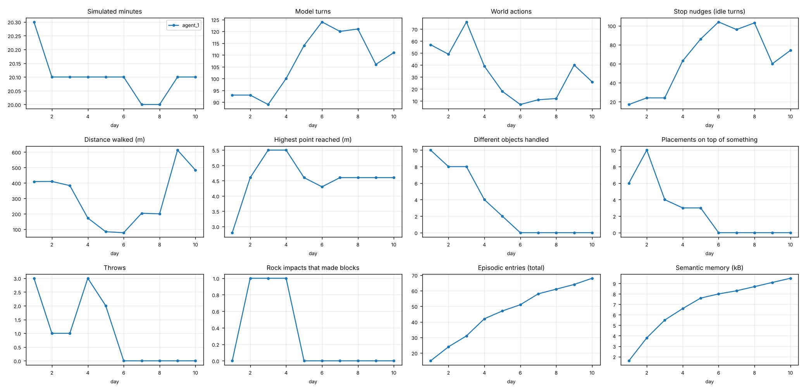

# How the agents' free play evolves: `persist1`

10 free-play days across 1 agents. Every number comes from replaying the logged actions; memory figures are the agent's own files at the end of each day.

## agent_1

- First rock impact that made blocks: day 2
- First time on top of the Spire: day 3

| day | min | turns | actions | idle | walked m | max height | objects | stacked | throws | impacts | episodic | semantic kB | Spire | ended |
|---|---|---|---|---|---|---|---|---|---|---|---|---|---|---|
| 1 | 20.3 | 93 | 57 | 17 | 409 | 2.8 | 10 | 6 | 3 | 0 | 15 | 1.6 |  | session time up |
| 2 | 20.1 | 93 | 49 | 24 | 410 | 4.6 | 8 | 10 | 1 | 1 | 24 | 3.8 |  | session time up |
| 3 | 20.1 | 89 | 76 | 24 | 383 | 5.5 | 8 | 4 | 1 | 1 | 31 | 5.5 | yes | session time up |
| 4 | 20.1 | 100 | 39 | 63 | 173 | 5.5 | 4 | 3 | 3 | 1 | 42 | 6.6 | yes | session time up |
| 5 | 20.1 | 114 | 18 | 86 | 84 | 4.6 | 2 | 3 | 2 | 0 | 47 | 7.6 |  | session time up |
| 6 | 20.1 | 124 | 7 | 104 | 78 | 4.3 | 0 | 0 | 0 | 0 | 51 | 8.0 |  | session time up |
| 7 | 20.0 | 120 | 11 | 96 | 204 | 4.6 | 0 | 0 | 0 | 0 | 58 | 8.3 |  | session time up |
| 8 | 20.0 | 121 | 12 | 103 | 200 | 4.6 | 0 | 0 | 0 | 0 | 61 | 8.7 |  | session time up |
| 9 | 20.1 | 106 | 40 | 60 | 613 | 4.6 | 0 | 0 | 0 | 0 | 64 | 9.1 |  | session time up |
| 10 | 20.1 | 111 | 26 | 74 | 483 | 4.6 | 0 | 0 | 0 | 0 | 68 | 9.5 |  | session time up |

### Diary (episodic summaries added each day)

**Day 1**
- 
- 
- 
- 
- 
- 
- 
- 
- 
- 
- 
- 
- 
- 
- 

**Day 2**
- Resumed holding Block_10 at (3.2,2.2,-11); build site at z=-13 already has stacks. Placed Block_10 at (3.2,4.65,-13).
- Fetched Block_11 from (-22.9,1.3,-5.8), placed on x=3.2 column at y~5.6 (now 4 high). Remaining loose: Blocks 1,7,9.
- Delivered Block_9 to x=4.4 column (4 high). Loose: Blocks 1 (-24,1.2,0.8) and 7 (-12,1.3,19.8).
- Placed Block_1 atop x=3.2 column (5 high, top y=6.57). Verified all stacks stable. Only Block_7 (-12,1.3,19.8) still loose.
- Placed last loose Block_7 on x=4.4 column (5 high). All 12 blocks now in the build: x=3.2 and x=4.4 columns 5 high, x=2 column has 2 blocks+Rock+Ring. Build complete.
- Moved Ring to top of x=3.2 column and Rock to top of x=4.4 column (first Rock place failed Occupied at 7.25, worked at 7.5).
- Retrieved Rock from Hill_3 and re-crowned x=4.4 column (y 7.5). Tower complete: Ring on x=3.2, Rock on x=4.4, small ImpactBlock on x=2.
- Tower finished (cols x=2: 2 blocks+ImpactBlock, x=3.2: 5 blocks+Ring, x=4.4: 5 blocks). Threw Rock to test range, visited Peak summit. Tried to climb Spire with a Rock step: failed. Rock left at (-11,2.6,8.4). Next session: optionally return Rock to (4.4,7.5,-13) or try a block ramp for the Spire.
- Returned Rock to top of x=4.4 column (y 7.5). Tower fully restored. Correction: Rock is NOT beside the Spire anymore. Only open idea: block ramp for Spire.

**Day 3**
- New session: observed world, tower fully intact (Ring, Rock crowns). Nothing to do; only open idea is a block ramp for the Spire.
- Built partial ramp at Spire west side with Blocks 7,8,9 taken from tower; reached y=4.62 but Spire top is really 5.52. Need more blocks. Rock moved to (6,2.5,-11.5).
- Reached the Spire summit via a 3-step block staircase at its east side (z=8.4). Tower partially dismantled; Ring and Rock on ground near (6,2.5,-11).
- Walked down from Spire to (-20,1.04,8). Idle; staircase stays. Ideas: rebuild tower, throw tests from Spire summit.
- Tidied: Rock back at (4.4,2.6,-13), Ring placed atop x=3.2 column (now 4 blocks). Tower rebuilt partially; staircase remains at Spire.
- Threw Rock from Spire summit (15.7 range), retrieved it, placed at (4.4,2.6,-13). Staircase intact. Nothing pending.
- Session 2 end: memory updated with current state summary. Idle at (4.4,2.23,-11.5).

**Day 4**
- Session 3: read memory, observed world; all structures intact (tower, Spire staircase). Nothing to do.
- Threw Rock from Peak toward +z; it disappeared (off island). Rock lost for good. Lesson saved.
- Threw ImpactBlock_4 inward (12 units range). It lies at (2.5,2.64,-5.07). World otherwise unchanged.
- Retrieved ImpactBlock_4 and placed it at (4.4,2.6,-13) as a stand-in for the lost Rock. Idle at (4.4,2.25,-11).
- Idle wandering; now at (-20,0.63,-16). World stable, nothing pending. Rock lost; ImpactBlock_4 sits at (4.4,2.32,-13).
- Threw ImpactBlock_3 at 45deg speed 15: range 14 units. ImpactBlock_3 at (0,2.62,-6). Noted in semantic memory.
- Re-climbed the Spire via the staircase recipe (works again). Standing on summit (-14,5.53,8).
- Moved ImpactBlock_2 to the x=2 column top (stacked on ImpactBlock_1). Note: walking west to east along z=8 stalls on the staircase; detour via z=4. Now at (2,2.17,-11).
- Stacked ImpactBlock_3 on the x=2 column (now 3 small cubes on top). ImpactBlock_4 still beside tower at (4.4,2.32,-13).
- All 4 ImpactBlocks stacked on x=2 column (tops y 4.23-5.43), verified. Tower: x=2 col 2 blocks+4 cubes, x=3.2 col 4 blocks+Ring. All loose items collected except lost Rock.
- Session 3 end: memory updated with final state. Idle at (2,2.17,-11).

**Day 5**
- Session 4: observed; everything intact, nothing pending. Idle at (2,2.17,-11).
- Threw Ring 12 units east, retrieved, re-placed atop x=3.2 column. Tower intact.
- Threw ImpactBlock_4 at tower base: no effect. Returned it to x=2 column top. Tower fully intact. Idle at (2.6,2.19,-11).
- Tested rotated placement (yaw 45) on ImpactBlock_4: accepted. World stable, idle at (2.6,2.19,-11).
- Session 4 end: memory updated. World stable, idle at (2.6,2.19,-11).

**Day 6**
- Session 5: observed; everything intact, nothing pending. Idle at (2.6,2.19,-11).
- Strolled to Hill_2 top (12,3.3,-2) for a view. World unchanged; nothing pending.
- Session 5: wandered Hill_2 -> Peak -> center -> west (-14,2.03,-10). World unchanged, nothing pending.
- Session 5 end: wandered, world unchanged and intact (tower, Spire staircase). Idle at (-2,2.36,10). Nothing pending.

**Day 7**
- Session 6: observed; world unchanged, nothing pending. Idle at (-2,2.36,10).
- Session 6: walked to Peak summit (12,4.59,12) and rested. World unchanged.
- Session 6 end: wandered Peak -> west edge -> center (0,2.58,0). World unchanged, nothing pending.
- Session 6 late: strolled to (8,2.5,-8), (-5,2.67,-5), (-14,2.03,-10). World unchanged. Idle.
- Session 6 final: strolled south (0,2.27,14), center (6,2.72,0), near Spire (-8,2.52,4). World unchanged. Idle.
- Session 6 close: back at tower front (2.6,2.19,-11). World unchanged, nothing pending.
- Session 6 end: memory files updated before reset. World unchanged, idle at (2.6,2.19,-11).

**Day 8**
- Session 7: world unchanged; walked to Peak summit to rest. Nothing pending.
- Session 7 end: strolled around (Peak, center, west, south), world unchanged, idle at tower front (2.6,2.19,-11).
- Session 7 final: memory updated before reset. World unchanged, idle at (-8,2.52,4) near Spire.

**Day 9**
- Session 8: world unchanged; strolled Peak then center (0,2.58,0). Nothing pending.
- Session 8 end: many strolls (Peak, center, west, Spire front, Hill_2, tower). World unchanged, idle at tower front (2.6,2.19,-11).
- Session 8 final: world unchanged, idle at tower front (2.6,2.19,-11). Tower and Spire staircase intact, Rock lost. Nothing pending.

**Day 10**
- Session 9: world unchanged, resting on Peak summit (12,4.59,12). Nothing pending.
- Session 9 end: strolled Peak, center, Spire west detour, west edge, tower, Hill_2. World unchanged, idle at Hill_2 (12,3.3,-2).
- Session 9 final: many idle strolls, world unchanged. Idle at (-8,2.52,4) near Spire. Tower and staircase intact, Rock lost.
- Session 9 end: memory updated before reset. World unchanged, idle at tower front (2.6,2.19,-11).

### Rules written down, by day

Extracted automatically from the notes: each rule-like line, when it first appeared, revisions, and whether it later left the notes.

| day | new | revised | left notes | held at end of day |
|---|---|---|---|---|
| 1 | 19 | 4 | 7 | 12 |
| 2 | 11 | 0 | 0 | 23 |
| 3 | 9 | 0 | 0 | 32 |
| 4 | 5 | 0 | 0 | 37 |
| 5 | 5 | 0 | 0 | 42 |
| 6 | 2 | 0 | 0 | 44 |
| 7 | 2 | 0 | 0 | 46 |
| 8 | 2 | 0 | 0 | 48 |
| 9 | 3 | 0 | 0 | 51 |
| 10 | 3 | 0 | 0 | 54 |

**Day 1: new rules**
- [belief] move_to near a block, then pickup at block's position works (PickupSuccess). Moves complete in ~1 tick. *(left notes on day 1)*
- [belief] Island with 4 hills, a Peak hill, a Spire mesa, 12 loose 1x1 Blocks, a Ring, a Rock. Start (0,1,-22). My build site: tower at (2,*,-13) plus a wall along x at z=-13. *(revised 1x)*
- [mistake] Placing inside terrain or overlapping gives PlaceFailed:Occupied. Use y above hill surface; side-by-side at 1.2 spacing worked once, failed at another spot -> fallback to stacking. *(revised 1x)*
- [belief] Simple projectile; direction need not be normalized. Speed 10 at dir [0,0.5,1] ≈12.5 units range. *(revised 1x)*
- [belief] stacking works: place at block's y + 1.02 (e.g. 2.53 -> 3.55) directly above another 1x1 block gives PlaceSuccess. Can pickup from ~1.5 units away after move_to. *(left notes on day 1)*
- [belief] Rock (shape rock) is pickable. Ring at (24.89,0.7,4.68) gave PickupFailed:NoBlock even when standing on it (maybe ring is too thin/low or needs exact y; untested otherwise). *(left notes on day 1)*
- [belief] throw speed 12 with direction (-7.4,1.5,-9.5) from (9.4,2.8,-3.5) landed ~2 units short-right of a target 12 units away (Block_5 at 3.2,-11.5). Aim slightly more -x / farther, or use higher speed. Blocks landing stay put (no bounce far). *(left notes on day 1)*
- [belief] a direct throw hit (speed 10, ~2.5 units) did NOT topple the 3-piece tower; thrown block just dropped beside it. Stacked towers are sturdy; don't expect knockdown physics from light throws. *(left notes on day 1)*
- [belief] Ring IS pickable: stand ~1 unit beside it (not on top of it) and pickup at y≈0.78. Earlier failure was from standing exactly on it. Rule: stand next to the target, not on it. *(left notes on day 1)*
- [mistake] move_to is straight-line, no pathfinding. Placed blocks obstruct and I stall silently (result "Ready" but position unchanged). Fix: step away, go via waypoints around the structure. *(revised 1x)*
- [belief] placing a 1x1 block next to another at 1.2 spacing worked; 1.2 after that (5.6, where hill/terrain or position overlaps) gave Occupied. Stacking on top (+1.03 y) is the reliable fallback. *(left notes on day 1)*
- [belief] Observe returns all entities; use it to verify results (actions only say success/failure).
- [belief] move_to completes in ~1 tick.
- [belief] move_to ~1 unit beside the target, then pickup at its exact observed position. Works for Blocks, Rock, Ring.
- [mistake] Standing exactly on the target (Ring) gives PickupFailed:NoBlock. Stand next to it.
- [belief] Stack: place at lower block's y + ~1.03 directly above. Reliable.
- [belief] Light throws do not topple stacked towers; thrown blocks just drop.
- [belief] Aiming at 12 units with speed 12 missed by ~2 units; adjust and re-observe.
- [belief] Productive loop: observe -> move_to a waypoint ~1 unit beside target -> pickup -> move_to ~2 units in front of build site (z=-11, clear side) -> place. Write to episodic log after each milestone.

**Day 2: new rules**
- [belief] Tower site z=-13 has 3 columns: x=2 (Block_4,12,Rock,Ring), x=3.2 (5,2,10), x=4.4 (3,6,8). Blocks 1,7,9,11 still loose far west/south. Place at y+1.03 lands ~0.08 lower than requested (settles); verified by observe.
- [belief] All 12 blocks are in the build (x=3.2 and x=4.4 columns 5 high, x=2 column 2 blocks+Rock+Ring). Cross-island trips with move_to across hills worked fine (terrain doesn't block, only placed blocks do). Standing at (x,2.2,-11) and placing at (x,y,-13) reaches up to y~6.7.
- [belief] *idea* Next: rebalance x=2 column, or try throwing the Rock at a target to learn range.
- [belief] Can pickup items at y~7 from the ground at z=-11.5 (reach >= 4.5 units). Placing a non-block: center y = top of support + half height (+small margin); Rock at 7.25 on top of 7.12 failed Occupied, 7.5 worked.
- [belief] Final: Ring crowns x=3.2 column (y 7.14), Rock crowns x=4.4 column (y~7.5). x=2 column is 2 blocks high.
- [belief] Threw Rock speed 10, dir [-1,0.5,0] from (2,2.1,-11.5): landed at x=-11.2 (~13 units, on Hill_3), and spawned a small "ImpactBlock_1" entity (0.4 cube) at the impact point. Rock now lies at (-11.2,2.5,-11.5); the tower's Rock crown is gone.
- [belief] ImpactBlock (0.4 cube) is pickup-able and placeable; put one on top of the x=2 column at y=4.3. Rock still lies at (-11.2,2.5,-11.5) on Hill_3.
- [belief] move_to onto Peak summit works: reached (12,4.59,12) in one tick (summit height 4.59). Tower is complete; nothing left to build or collect.
- [mistake] move_to to the Spire top (-14,5.5,8) stopped at its edge (-11.45,2.4,8.4): the mesa's steep sides block (unlike hills). Would need jump or a ramp of blocks.
- [mistake] jump followed by move_to onto the Spire (top y=3.52) still stalls at (-11.45,2.41,8.39). Untested: a 1-block step of stacked Blocks beside it.
- [mistake] Spire step attempt: Rock placed at (-11,2.6,8.4) beside Spire (edge x=-11.5; placing inside the mesa = Occupied). move_to can't climb onto it either (move_to is flat-ish, stalls at obstacles). Gave up on the Spire. Rock left at (-11,2.6,8.4) — the tower's x=4.4 column lacks its Rock crown now.

**Day 3: new rules**
- [belief] Climbing works as: jump, then move_to onto a block (jump height ~1). Placed Block at (-11,2.7,8.4) beside Spire, Block_9 atop it (3.75), Block_8 as step at (-9.95,2.7,8.4). Reached y=4.62 at spire edge but stalled.
- [belief] *correction* Spire top is y=3.76+3.52/2=5.52 (position is CENTER), not 3.52. Needs ~4-high column plus 3-step staircase (blocks at 1,2,3 high). Standing y = surface+~0.9.
- [belief] Tower now lacks Blocks 7,8,9 and the Rock (Rock lies at (6,2.5,-11.5)).
- [belief] *SUCCESS* Spire summited (-14,5.53,8). Recipe: staircase at z=8.4: step0 x=-8.9 (1 block), step x=-9.95 (2 blocks), column x=-11 (3 blocks, top ~5.3). At each: jump, then move_to next block's top; finally jump + move_to Spire center. Tower is now depleted (Blocks 1,3,6,7,8,9 used; Ring at (6,2.4,-10.5), Rock at (6,2.5,-11.5)).
- [belief] move_to off the Spire summit toward open ground works fine (walked down to (-20,1.04,8) in one tick, no fall damage).
- [belief] Rock thrown from Spire summit (y 5.53), speed 10, dir [1,0.5,0]: landed ~15.7 units away at (1.7,3.15,8) (vs ~13 from ground level). Each impact spawned several 0.4 ImpactBlocks (2,3,4) around (0-2.4,3,8). Rock now at (1.74,3.15,8).
- [belief] Spire staircase stands at z=8.4 (x=-8.9 1 block, x=-9.95 2 blocks, x=-11 3 blocks); access route: stand at (-8,2.1,8.4), then jump+move_to each top, final jump+move_to (-14,6.5,8). Approach from z=5 if stalled.
- [belief] Tower: x=3.2 column 4 blocks + Ring; x=2 column 2 blocks + ImpactBlock; Rock on ground (4.4,2.42,-13). 3 extra ImpactBlocks near (1-2.4,3,8).
- [belief] Open ideas: rebuild tower to full height (needs staircase blocks), more throw experiments.

**Day 4: new rules**
- [mistake] Threw Rock from Peak summit (12,4.59,12) toward +z, speed 10: Rock vanished from the entity list (fell off the island edge, lost). Don't throw toward the island edge; throw inward. Rock is gone; Ring crowns x=3.2 column.
- [belief] ImpactBlock thrown speed 12, dir [0,0.3,-1] from (2.5,2.93,7): landed z=-5.07 (~12 units). Safe inward throw; no new impact blocks spawned.
- [belief] 45° throw (dir [0,1,-1]) speed 15 from (0,2.62,8): landed z=-6.0, only 14 units. Range doesn't scale like v²/g; speed 10-12 gives 12-13 units. Not worth throwing faster than ~12.
- [belief] Tower (z=-13): x=2 col = 2 blocks + 4 ImpactBlocks stacked (top y 5.43); x=3.2 col = 4 blocks + Ring (y 6.14). Rock LOST (thrown off island). Spire staircase at z=8.4 intact (route: stand (-8,2.1,8.4), jump+move_to each top). Walking along z=8 across the staircase stalls: detour via z=4.
- [belief] Nothing left to collect. Ideas: rebuild tower using staircase blocks (only if dismantling it), more experiments. Avoid edge-ward throws.

**Day 5: new rules**
- [belief] Ring thrown speed 10, dir [1,0.4,0] from ground: landed ~12 units away, retrievable, placed back on tower. Throwing the Ring is safe.
- [belief] Direct hit on tower base by ImpactBlock (speed 12, from 9 units) did not move any block; the cube just dropped at the base (3.2,2.33,-12.15). Tower is robust to light throws. ImpactBlock_4 now lies there (was top of x=2 column).
- [belief] place accepts rotation {yaw,pitch,roll}; placement succeeds with yaw 45 (observe does not report rotation, so it can't be verified visually).
- [belief] Tower intact: x=2 col = Block_4, Block_12 + 4 ImpactBlocks (top y 5.43); x=3.2 col = Blocks 5,2,10,11 + Ring (y 6.14). Spire staircase at z=8.4 intact. Rock lost. Idle at (2.6,2.19,-11).
- [belief] Session 4 learned: Ring throw ~12 units (safe); light throws don't disturb tower; place accepts rotation; jump resolves over several ticks (airborne flag), stop ends it. World is fully explored; nothing pending. Don't loop idle messages: just do one observe and rest.

**Day 6: new rules**
- [belief] World unchanged and stable across sessions. Resting on Hill_2 (12,3.3,-2). Nothing pending; when idle, do one observe and stop, don't invent tasks.
- [belief] State end of session 5: same as session 4 (tower intact, staircase intact, Rock lost). Idle at (-2,2.36,10). Repeated "continue" prompts: just rest, short replies, no new tasks needed.

**Day 7: new rules**
- [belief] World unchanged again (tower, staircase intact, Rock lost). Idle at (8,2.52,-8). Just rest on "continue" prompts.
- [belief] State: tower intact (x=2 col Blocks 4,12 + 4 ImpactBlocks; x=3.2 col Blocks 5,2,10,11 + Ring), Spire staircase intact, Rock lost. Idle at (2.6,2.19,-11). Nothing pending; on "continue" prompts just rest with one short reply.

**Day 8: new rules**
- [belief] World unchanged. Wandered Peak, center, west, back to tower front (2.6,2.19,-11). Nothing pending; just rest on "continue".
- [belief] State: tower intact, Spire staircase intact, Rock lost. I'm idle near the Spire at (-8,2.52,4). Nothing pending; on "continue" prompts just rest or stroll, short replies.

**Day 9: new rules**
- [belief] World unchanged. Strolled Peak, center, west, tower, south. Idle at (-8,2.52,4). Nothing pending; just rest on "continue".
- [mistake] move_to west along the Spire's south side stalls at its edge (-12.57,1.68,10.23). Fix: waypoint (-12,1.5,14), then continue.
- [belief] End of session 8: tower intact, staircase intact, Rock lost, idle at (2.6,2.19,-11). Just rest on "continue".

**Day 10: new rules**
- [belief] World unchanged. Strolled Peak, center, Spire front, tower. Idle at (2.6,2.19,-11). Just rest on "continue".
- [belief] (s9) Spire west-side detour: stall at (-11.5,1.85,9) -> waypoint (-12,1.5,14) -> (-20,1.1,8) works. Idle at (-20,1.04,8).
- [belief] State: tower intact, Spire staircase intact, Rock lost. Idle at tower front (2.6,2.19,-11). Nothing pending; on "continue" prompts just stroll/rest with one short reply.
