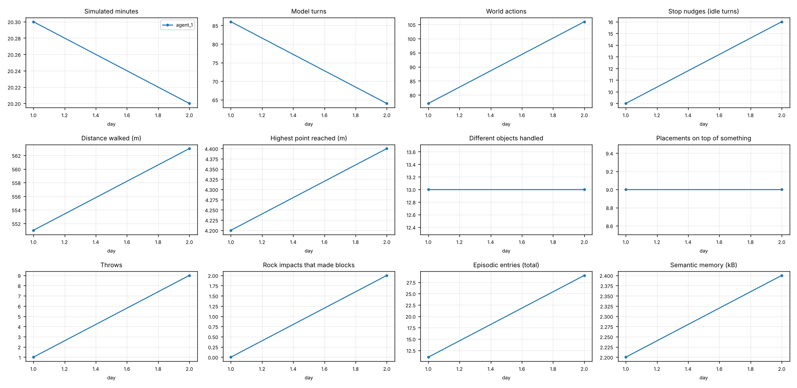

# How the agents' free play evolves: `pilot-20261024-005431`

2 free-play days across 1 agents. Every number comes from replaying the logged actions; memory figures are the agent's own files at the end of each day.

## agent_1

- First rock impact that made blocks: day 2
- First time on top of the Spire: never

| day | min | turns | actions | idle | walked m | max height | objects | stacked | throws | impacts | episodic | semantic kB | Spire | ended |
|---|---|---|---|---|---|---|---|---|---|---|---|---|---|---|
| 1 | 20.3 | 86 | 77 | 9 | 551 | 4.2 | 13 | 9 | 1 | 0 | 11 | 2.2 |  | session time up |
| 2 | 20.2 | 64 | 106 | 16 | 563 | 4.4 | 13 | 9 | 9 | 2 | 29 | 2.4 |  | session time up |

### Diary (episodic summaries added each day)

**Day 1**
- Picked up a block and placed it nearby on my first outing.
- Started a two-block tower by stacking Block_5 on Block_4.
- Fetched Block_3 from across the hill and made the tower three blocks tall.
- Added Block_12 to the tower, making it four blocks tall.
- Placed Block_6 (purple) on the tower, making it five blocks.
- Tower reached six blocks after adding Block_10.
- Added Block_8 as the seventh block of the tower after one out-of-range failure.
- Built a step block beside the tower and climbed it to place an eighth tower block (pink).
- Used every block on the island: finished a 10-high tower with a staircase beside it.
- Cleaned up semantic memory and headed toward the Ring before the reset.
- Picked up the Ring and threw it, testing the throw tool for the first time.

**Day 2**
- Found the world reset, then threw the Rock onto Peak.
- Threw the Rock hard and it spawned impact debris on landing.
- Threw Block_3 across a hill to compare with the Rock.
- Threw the Rock gently and got no debris.
- Threw the Rock at speed 20 and saw no debris.
- Confirmed fast Rock throws spawn impact debris.
- Threw the Rock at speed 25 and still got no debris.
- Threw a block at speed 50 and it only went about 11 units.
- Stacked Block_3 on Block_10 on the hill near Spire.
- Added Block_7 to make a three-block tower near Spire.
- Made the Spire-side tower four blocks tall with Block_9.
- Topped the tower at five blocks with Block_1.
- Added Block_11, making the Spire-side tower six blocks tall.
- Got stuck at my tower, then built a step block and made it seven blocks tall.
- Placed Block_8 at y~9.9, making the tower eight blocks tall.
- Finished a 9-block tower with a stair and 2-block column, using all 12 blocks.
- Reorganized semantic memory before the reset.
- Threw the Ring at speed 30 and got no debris.
